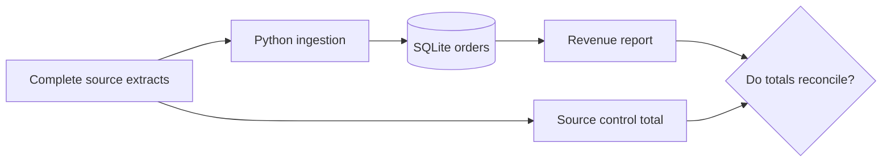

# Missing Revenue Lab

**The pipeline is green. The revenue is wrong. Can you explain why?**

A small, runnable data-engineering incident challenge by [YECA2K](https://github.com/YECA2K).
Investigate a fictional shop's missing revenue, repair the Python/SQLite ingestion code,
and prove the repair with automated acceptance checks.

**Free · local · synthetic data · no Docker · no cloud account · no API keys**

## The incident

The source system reports **EUR 100,000.00**. The warehouse reports **EUR 95,000.00**.
Both scheduled jobs completed successfully. Finance asks where the missing **EUR 5,000.00** went.

Your job is to explain the discrepancy, fix the loader, and make the repair safe for repeated
deliveries and corrections. This is an investigation, not a copy-along tutorial.



## Run in two commands

Requires **Python 3.11+** with SQLite support. There are no third-party dependencies.
Clone or download this repository and open a terminal in its root directory.

```sh
python -m lab.demo
python -m unittest discover -s tests -v
```

On Windows, use `py` instead of `python` if that is how your installation is configured.
**Four failing tests are expected in the starter.** They are the incident to investigate,
not an installation error. Four checks already pass; keep them passing.

Expected demo output includes:

```text
Source: EUR 100,000.00 | Warehouse: EUR 95,000.00
Missing: EUR 5,000.00
Pipeline execution succeeded. Does that mean its data is correct?
```

## Your mission

1. Read [the incident brief](docs/incident.md) and the source contract.
2. Run the demo and inspect `lab/fixtures.py` and `lab/pipeline.py`.
3. Record a root-cause hypothesis before changing the loader.
4. Repair **`lab/pipeline.py`**. Keep the `Pipeline` public interface unchanged.
5. Get all eight acceptance checks passing without modifying the tests or fixtures.
6. Explain the tradeoff you made and one limitation your implementation still has.

The exercise is intended for learners with basic Python and SQL knowledge.
Allow roughly 45–90 minutes, depending on experience; this is an estimate, not a measured benchmark.

## Repository map

| Path | Purpose |
| --- | --- |
| `lab/pipeline.py` | Intentionally faulty loader: edit this |
| `lab/fixtures.py` | Synthetic source extracts |
| `lab/demo.py` | Reproduce the headline discrepancy in memory |
| `tests/test_pipeline.py` | Eight public acceptance checks |
| `docs/incident.md` | Source contract, timeline and acceptance criteria |
| `docs/hints.md` | Progressive hints; contains spoilers |
| `solutions/` | Reference implementation; contains spoilers |
| `docs/solution.md` | Root cause, repair and production limitations |
| `tools/verify.py` | Maintainer verification of starter and reference |

## Stuck?

Open [the hints](docs/hints.md) one at a time. The [reference walkthrough](docs/solution.md)
and `solutions/pipeline.py` contain the answer. Try the investigation first.

## What this demonstrates

- A successful job is not evidence of correct data.
- Arrival time and source update time are different concepts.
- Row identity, correction handling and idempotency affect revenue.
- A timestamp watermark is only safe under explicit source guarantees.
- Small deterministic tests can reproduce a large business discrepancy.

This is a deliberately small teaching system, not a production reconciliation product.
See the source contract and limitations before adapting it.

## Share your investigation

Found a bug in the exercise or a setup problem? Open an issue with your Python version,
command and error output. Do not attach employer or customer data.
For solution discussions, label the title **[SPOILER]**. No job outcomes or certificates are promised.

## Maintainer verification

```sh
python tools/verify.py
python -m lab.demo --solution
```

CI checks Python 3.11–3.14 on Linux and Windows. Local validation details are in
[VALIDATION.md](VALIDATION.md). A green CI run means the starter has its expected failures
and the reference passes; it does **not** mean the starter is repaired.

## Authorship and license

Published and maintained under **YECA2K**. Code, synthetic fixtures and documentation were
developed with OpenAI Codex assistance. The scenario is fictional and does not claim to describe
the maintainer's employment history. No real customer records or employer code are included.

MIT licensed. You may learn from, modify and share the project under the license terms.
