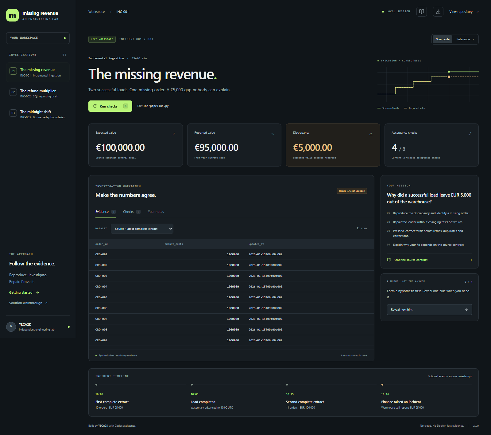
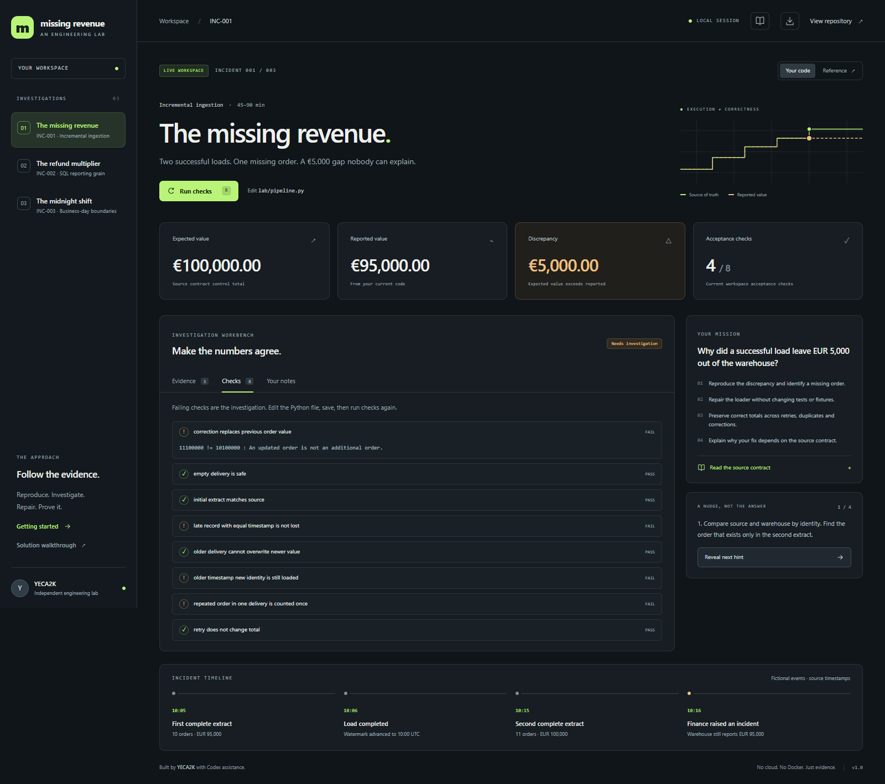
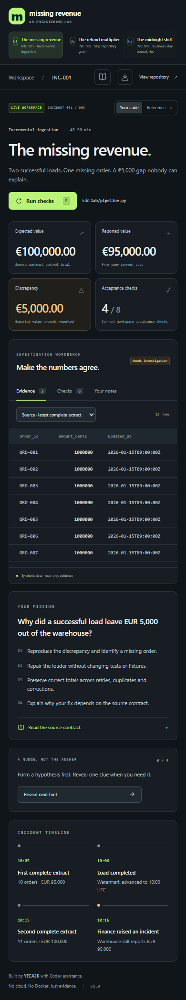
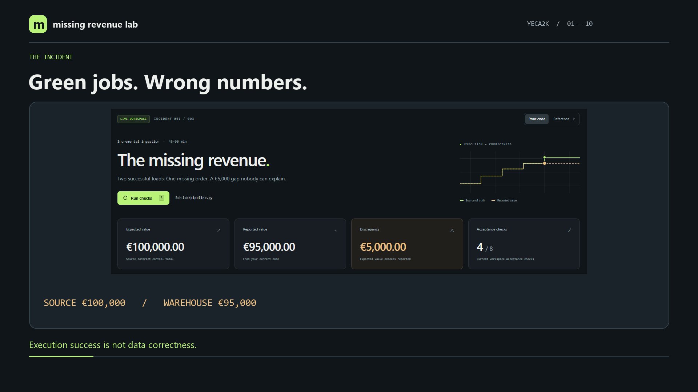
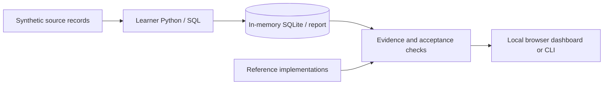

<div align="center">

# Missing Revenue Lab

### The pipeline is green. The numbers aren't.

**Three data incidents. A local investigation workspace. Repairs you can prove.**

[](https://github.com/YECA2K/missing-revenue-lab/actions/workflows/verify.yml)


[Get started](#start-in-one-minute) · [The incidents](#three-incidents-three-different-failure-modes) · [Solution video](#watch-the-walkthrough-spoilers) · [Setup guide](docs/GETTING_STARTED.md)

</div>



A practical Python/SQL challenge collection published by **[YECA2K](https://github.com/YECA2K)**.
Investigate fictional data failures, repair the learner code, and verify your reasoning with
**27 acceptance checks**. Includes a responsive local dashboard, progressive hints, synthetic
evidence, reference implementations, and an explained video walkthrough.

**No Docker. No virtualization. No cloud account. No API keys. No third-party runtime packages.**

## Start in one minute

Install Python **3.11+** with SQLite support, then:

```sh
git clone https://github.com/YECA2K/missing-revenue-lab.git
cd missing-revenue-lab
python -m lab serve --open
```

The dashboard opens at **http://127.0.0.1:8765**. Keep the terminal running; press **Ctrl+C** to stop.
Use `py` on Windows or `python3` on macOS/Linux if that is your Python command.
Windows users can also double-click **`start-lab.cmd`** after extracting the complete project.

Git is optional: [download the release](https://github.com/YECA2K/missing-revenue-lab/releases/latest)
or use GitHub's **Code → Download ZIP**. No installation with pip is required to run the lab.

Check your environment with `python -m lab doctor`. Port in use? Add `--port 8766`.
See [the full setup guide](docs/GETTING_STARTED.md) for troubleshooting and terminal-only use.

## Three incidents, three different failure modes

| Incident | What you investigate | Repair workspace | Starter checks |
| --- | --- | --- | --- |
| **INC-001 · The missing revenue** | A successful loader silently drops an order. EUR 100,000 becomes EUR 95,000. | `lab/pipeline.py` | 4 / 8 pass |
| **INC-002 · The refund multiplier** | Joining items and refunds turns EUR 130 into EUR 410. | `lab/refunds.py` | 4 / 8 pass |
| **INC-003 · The midnight shift** | UTC date slicing assigns orders to the wrong business day. EUR 300 becomes EUR 250. | `lab/daily_revenue.py` | 2 / 11 pass |

Read the source contracts: [INC-001](docs/incident.md),
[INC-002](docs/incidents/refund-multiplier.md), [INC-003](docs/incidents/midnight-shift.md).

**The learner code is intentionally faulty.** Failing acceptance checks are the exercise, not a
broken installation. Reference implementations pass all 27 checks. A green repository CI run
verifies the application and references; it does not mean the starter has been repaired.

## Your investigation loop

1. **Reproduce:** inspect the discrepancy and incident timeline.
2. **Investigate:** read the source contract, compare evidence tables, and record a hypothesis.
3. **Repair:** edit the indicated Python file in your editor and save it.
4. **Prove:** click **Run checks** or press **R** outside a text field.
5. **Explain:** export your notes as Markdown, including the evidence and remaining limitations.

The dashboard evaluates your saved code in a fresh process. It does not edit it.
The spoiler-gated **Reference** view evaluates the supplied solution without replacing your files.
Browser notes are local to the browser profile and incident; export them before clearing storage.

<details>
<summary><strong>See the acceptance-check interface</strong></summary>



</details>

<details>
<summary><strong>See mobile layout</strong></summary>



</details>

## Watch the walkthrough (spoilers)

[](https://github.com/YECA2K/missing-revenue-lab/releases/download/v1.0.0/solution-walkthrough.mp4)

**[Watch / download the 1080p MP4](https://github.com/YECA2K/missing-revenue-lab/releases/download/v1.0.0/solution-walkthrough.mp4)**
· approximately **4 minutes 29 seconds** · synthetic English narration · burned-in captions.

Or choose **Solution walkthrough** in the local dashboard. On mobile, open **Getting started**
using the book icon, then choose the video. The video explains all three root causes and repairs
using actual dashboard captures and annotated code; it is a generated walkthrough, not a live
recording of someone solving the lab.

[Transcript and chapters](docs/VIDEO.md) · [SRT captions](docs/media/solution-walkthrough.srt)
· [Video source script](docs/video-script.json).

## Prefer the terminal?

```sh
python -m lab list
python -m lab demo --case revenue
python -m lab check --case revenue
python -m lab check --case grain
python -m lab check --case timezone
```

`check` exits with code **1** while checks fail and **0** when all pass. Add `--solution` to run
the reference (spoilers). Use `python -m lab state --case revenue` for JSON evidence.
The original `python -m lab.demo` command remains available for INC-001.

## Architecture



The runtime uses Python's standard library, SQLite and plain HTML/CSS/JavaScript.
The HTTP server binds only to loopback and serves a fixed set of project assets. Every check
uses fresh synthetic data. There is no telemetry, external AI call, account system or cloud storage
in the application. The optional repository link leaves the local app when you click it.

This is a developer tool that executes locally trusted Python code, **not a sandbox for untrusted
submissions**. Its worker timeout is not a security boundary. It is not designed to be exposed to
the internet. Regional daylight-saving rules, production financial controls and large-scale data
ingestion are explicitly outside the exercises' contracts.

## Repository guide

| Path | Purpose |
| --- | --- |
| `lab/pipeline.py`, `lab/refunds.py`, `lab/daily_revenue.py` | Learner workspaces |
| `lab/web/` | Responsive investigation interface |
| `lab/cases.py`, `lab/fixtures.py` | Incident catalog and synthetic records |
| `lab/runner.py`, `lab/server.py`, `lab/__main__.py` | Evidence collection, local server and CLI |
| `tests/test_pipeline.py`, `tests/test_refunds.py`, `tests/test_daily_revenue.py` | 27 learner acceptance checks |
| `tests/test_system.py` | Application regression checks |
| `solutions/` | Explained reference implementations — spoilers |
| `docs/` | Setup, incident briefs, validation, video and images |
| `tools/` | Maintainer verification and optional media production |

## Verification and contributions

```sh
python tools/verify.py
python -m unittest tests.test_system -v
```

These must pass even though the learner code is initially wrong. CI runs on Windows and Linux
with Python 3.11–3.15, plus a Chromium browser job. See [validation](VALIDATION.md) for what was
actually tested and [contribution instructions](CONTRIBUTING.md) for browser/media tooling.

Open an issue for setup or exercise problems. Include your OS, Python version, command and
error text. Use **[SPOILER]** in solution discussion titles. Never attach employer or customer data.

## Authorship and license

Published and maintained under **YECA2K**. Code, synthetic data, interface, documentation and
video were developed with **OpenAI Codex assistance**. Video narration is synthetic. The incidents
are fictional; they do not claim to describe the maintainer's employment history.

**MIT licensed.** All three challenges and references in this repository are free. No certificate,
job outcome, learning outcome or business revenue is promised.
